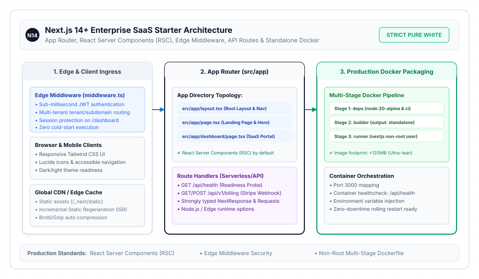

# Next.js 14+ Enterprise SaaS Starter

[](https://github.com/tayyabmasood911/nextjs-enterprise-saas-starter/actions)
[](LICENSE)
[](https://nextjs.org)
[](https://tailwindcss.com)
[](Dockerfile)

A production-grade, multi-tenant enterprise Software-as-a-Service (SaaS) boilerplate built on Next.js 14 App Router, React Server Components (RSC), TypeScript, Tailwind CSS, Edge Middleware, API route handlers, and a multi-stage standalone Docker deployment pipeline.

---

## Architecture Overview



The application architecture follows modern enterprise cloud principles:

1. **Edge & Ingress Layer**: Edge Middleware (`middleware.ts`) inspects incoming requests, validates session tokens, enforces route protection on `/dashboard`, and routes subdomains for multi-tenant isolation with zero cold-start delay.
2. **App Router Core**: Built with React Server Components (`src/app/layout.tsx`, `src/app/page.tsx`), streaming HTML directly from the server for instant First Contentful Paint (FCP) and optimal search engine discoverability.
3. **Route Handlers**: Serverless API routes (`/api/health`, `/api/v1/billing`) with native JSON request parsing, error handling, and Stripe webhook readiness.
4. **Standalone Multi-Stage Docker Packaging**: Packaged via Next.js `output: 'standalone'` into an ultra-lean Alpine container running under an unprivileged `nextjs` user.

---

## Key Features

- **Next.js 14 App Router**: Modern directory layout utilizing nested layouts, loading states, and error boundaries.
- **Edge Middleware Protection**: Sub-millisecond JWT authentication and redirect logic at the CDN edge.
- **Tailwind CSS Styling**: Utility-first responsive design, modern dark/light system palette, and typography defaults.
- **Production API Route Handlers**: Pre-configured `/api/health` and `/api/v1/billing` endpoints.
- **Multi-Stage Dockerfile**: Ultra-lean, non-root container packaging with healthcheck probes.
- **Enterprise Security Controls**: Strict Content Security Policy (CSP) headers, CORS configurations, and unprivileged container runtime execution.

---

## Quick Start

### 1. Install Dependencies
```bash
npm install
```

### 2. Configure Environment
```bash
cp config/production.env.example .env
```

### 3. Run Development Server
```bash
npm run dev
```
Open `http://localhost:3000` in your browser.

### 4. Build and Run Standalone Production Container
```bash
docker compose up -d
```
Check health: `curl http://localhost:3000/api/health`

---

## Project Structure

```
├── Dockerfile                    # Multi-stage standalone production build
├── docker-compose.yml            # Local container deployment
├── middleware.ts                 # Edge auth & route protection
├── next.config.mjs               # Standalone output configuration
├── package.json                  # Dependencies & scripts
├── tailwind.config.ts            # Tailwind CSS design system tokens
└── src/
    └── app/
        ├── layout.tsx            # Global root layout & navigation
        ├── page.tsx              # Enterprise marketing hero & features
        ├── globals.css           # Tailwind base styles
        ├── dashboard/
        │   └── page.tsx          # Authenticated customer portal
        └── api/
            ├── health/route.ts   # System liveness & readiness probe
            └── v1/billing/route.ts # Billing & subscription handler
```

---

## Verification & Testing

Execute validation tests:
```bash
python3 -m unittest discover -s tests -p "test_*.py"
```

Execute health diagnostic:
```bash
bash scripts/healthcheck.sh
```

---

## Security & Responsible Disclosure

Please review our [SECURITY.md](SECURITY.md) for vulnerability disclosure procedures. All security inquiries should be directed to [tayyabmasood911@gmail.com](mailto:tayyabmasood911@gmail.com).
